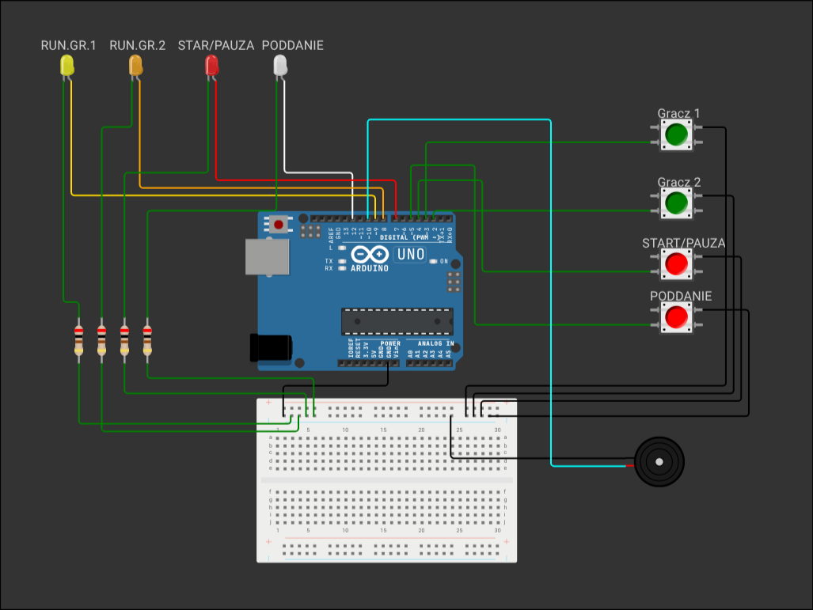

# Zegar szachowy (AVR / Arduino Uno)

Zegar szachowy w C na ATmega328P (Arduino Uno). Projekt jest w trakcie budowy.



## Status

- [x] Konfiguracja pinów (`pin_conf.h`) i własne makra bitowe (`bitops.h`)
- [x] Test sprzętu: miganie diodą LED na PD2 (D2)
- [x] utworzenie schematow blokowych

### TODO:

- [ ] zmiana nazw makr/zmiennych na polski

### Zadania A:

- [x] Podłączenie przycisków i obsługa przerwan
- [x] Podłączenie buzzlera
- [ ] Ustawienie czasu przed partią
- [ ] Przełączanie czasu miedzy graczami

### Zadania B:

- [ ] Podłączenie diod i odliczanie czasu na przerwaniu timera
- [ ] Podłączenie wyświetlacza LCD i wyświetlanie czasu oraz komunikatow
- [ ] Pauza i wznowienie
- [ ] Poddanie partii i koniec czasu

## Struktura projektu

```
.
├── img/
│   └── uklad.png      # schemat połączeń
├── include/
│   ├── bitops.h       # makra do operacji na bitach
│   ├── gpio.h         # obsługa portów GPIO
│   └── pin_conf.h     # konfiguracja pinów i F_CPU
├── src/
│   └── main.c         # punkt wejścia programu
└── README.md
```

## Konfiguracja

Piny i taktowanie ustawia się w `include/pin_conf.h`:

```c
#define LED_DDR   DDRD
#define LED_PORT  PORTD
#define LED_PIN   PD2
```

`F_CPU` domyślnie wynosi `16000000UL` (Arduino Uno). Można go nadpisać flagą kompilatora.
Piny definiowane są przez nazwy portów (PD2), a nie numery Arduino (D2), dzięki czemu kod jest przenośny między Uno a gołą ATmega328P.

## Makra z `bitops.h`

| Makro                                   | Opis                                          |
| --------------------------------------- | --------------------------------------------- |
| `BIT(n)`                                | maska z jedynką na pozycji `n`                |
| `SET_BIT(reg, bit)`                     | ustawia bit na 1                              |
| `CLR_BIT(reg, bit)`                     | zeruje bit                                    |
| `TOGGLE_BIT(reg, bit)`                  | odwraca bit                                   |
| `READ_BIT(reg, bit)`                    | zwraca wartość bitu (0 lub 1)                 |
| `IS_SET` / `IS_CLR`                     | sprawdza, czy bit jest ustawiony / wyzerowany |
| `SET_MASK` / `CLR_MASK` / `TOGGLE_MASK` | operacje na wielu bitach naraz                |

## Templatka pin_conf.h (mozna nazwe zmenic tylko dodac do .gitignore)

````
#ifndef PIN_CONF_H
#define PIN_CONF_H

#include <avr/io.h>

#ifndef F_CPU
#define F_CPU 16000000UL
#endif // !F_CPU

/**
 * Wazny plik: tutaj beda znajdowac sie potrzebne
 * definicje pinow dla skalowalnosci aplikacji
 * oraz taktowanie ma byc przed bibl. <util/delay.h>
 *
 * ! TEN PLIK JEST TYLKO TEMPLATKĄ zmieniamy z .txt na .h
 * i bindujemy odpowiednie makra na cele naszego projektu/płytki
 *
 * Plytka: Arduino Uno
 * Piny 0-7   -> port D (PD0-PD7)
 * Piny 8-13  -> port B (PB0-PB5)
 * Piny A0-A5 -> port C (PC0-PC5)
 */

// REJESTRY PORTOW

// INFO: wejscie/wyjscie (1 = wyjscie, 0 = wejscie)
#define KIERUNEK_SZYNA_B
#define KIERUNEK_SZYNA_C
#define KIERUNEK_SZYNA_D

// INFO: zapis stanu (wyjscie) lub pull-up (wejscie)
#define STAN_PORT_B
#define STAN_PORT_C
#define STAN_PORT_D

// INFO: odczyt aktualnego stanu pinow
#define ODCZYT_PORT_B
#define ODCZYT_PORT_C
#define ODCZYT_PORT_D

// DIODY LED (wyjscia)

// INFO: dioda 1 (zolta) - ruch gracza 1
#define LED1_DDR
#define LED1_PORT
#define LED1_PIN

// INFO: dioda 2 (pomaranczowa) - ruch gracza 2
#define LED2_DDR
#define LED2_PORT
#define LED2_PIN

// INFO: dioda 3 (czerwona) - START/PAUZA
#define LED3_DDR
#define LED3_PORT
#define LED3_PIN

// INFO: dioda 4 (biala) - PODDANIE
#define LED4_DDR
#define LED4_PORT
#define LED4_PIN

// INFO: wbudowana dioda "L"
#define LED_L_DDR
#define LED_L_PORT
#define LED_L_PIN

// INFO: buzzler
#define BUZZLER_DDR
#define BUZZLER_PORT
#define BUZZLER_PIN

// PRZYCISKI (wejscia z pull-upem, wcisniety = 0, drugi styk do GND)

// INFO: przycisk 1 - gracz 1
#define BTN1_DDR
#define BTN1_PORT
#define BTN1_PIN
#define BTN1_BIT

// INFO: przycisk 2 - gracz 2
#define BTN2_DDR
#define BTN2_PORT
#define BTN2_PIN
#define BTN2_BIT

// INFO: przycisk 3 - START/PAUZA
#define BTN3_DDR
#define BTN3_PORT
#define BTN3_PIN
#define BTN3_BIT

// INFO: przycisk 4 - PODDANIE
#define BTN4_DDR
#define BTN4_PORT
#define BTN4_PIN
#define BTN4_BIT

#endif // !PIN_CONF_H```
````
